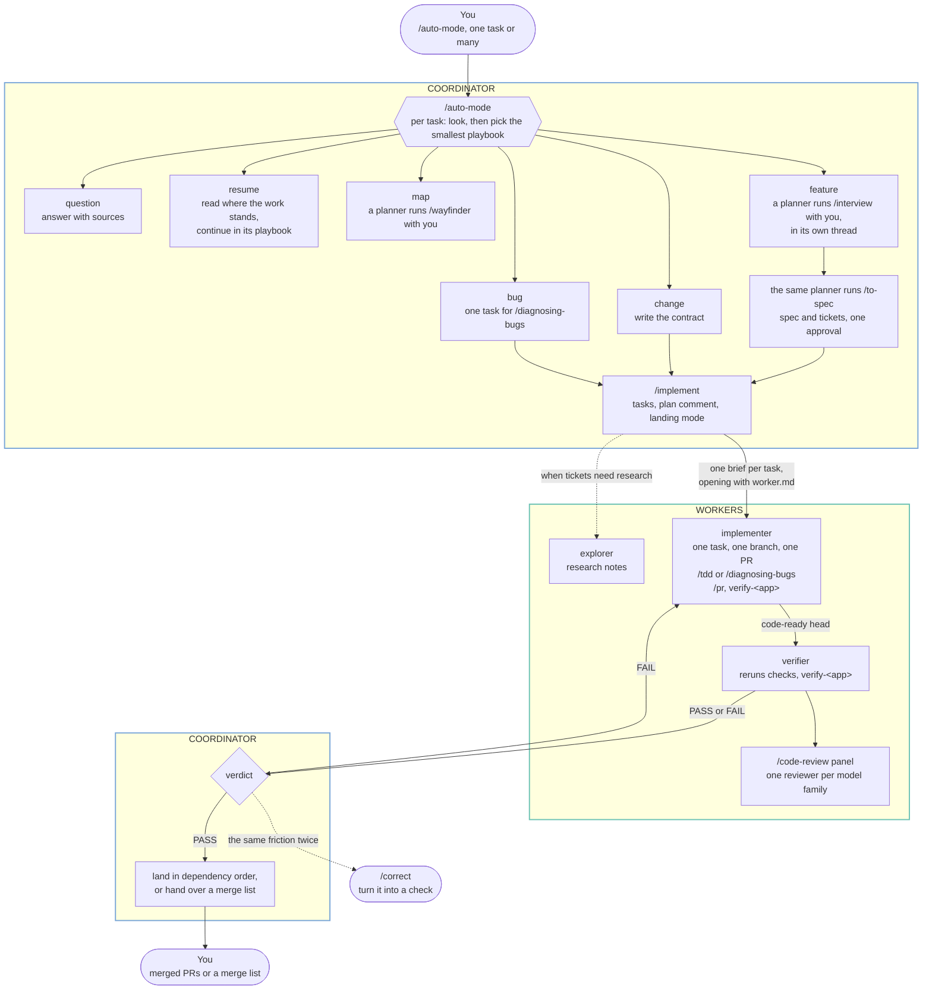

# skills
Dante's agent skills

## How the skills fit together

Start with [`/auto-mode`](./skills/auto-mode/SKILL.md) and hand it your tasks, one or several at once: bugs, features, issues, questions, PRs to merge. The agent you typed it to becomes the **coordinator**: the one agent you talk to, whose job is that every task ships. It starts a worker for each piece of work and stays free for you.

1. **It picks a playbook** for each task by its size: `question`, `bug`, `change`, `feature`, `map`, or `resume` for work already in flight.
2. **A planner settles what to build.** For a `feature`, a **planner** interviews you in its own thread, then writes the spec and its tickets, which you approve once. A `change` or a `bug` needs only a short contract from the coordinator.
3. **Workers build it.** The coordinator starts an **implementer** for each task, and each one opens a PR.
4. **Workers check it.** A **verifier** that did not write the code gives each PR a verdict, `PASS` or `FAIL`.
5. **It lands.** The coordinator merges the PRs that passed, or hands you a merge list when merging is yours.

Workers are subagents that run in the background, each with one job. In the diagram, work moves top to bottom, and dotted arrows are side paths. [GLOSSARY.md](./GLOSSARY.md) defines the terms.

The flow lives in four places:

| File | Who reads it | What it holds |
| --- | --- | --- |
| [`auto-mode/SKILL.md`](./skills/auto-mode/SKILL.md) | The coordinator | How to take in tasks, pick a playbook for each, and start planners |
| [`auto-mode/playbooks/`](./skills/auto-mode/playbooks) | The coordinator | The steps for each size of task |
| [`implement/SKILL.md`](./skills/build/implement/SKILL.md) | The coordinator | How to plan, start workers, judge their work, and land it. [`events.md`](./skills/build/implement/events.md) covers what can happen along the way |
| [`implement/worker.md`](./skills/build/implement/worker.md) | Every worker | The rules for planning, building, and verifying |

The diagram follows one task. With several, each takes its own path from the top, and they share the build at the bottom.

Outside this flow, type these directly: [setup-skills](./skills/setup/setup-skills/SKILL.md) once per repo, [triage](./skills/plan/triage/SKILL.md) for what on the tracker needs attention, and [improve-codebase-architecture](./skills/codebase/improve-codebase-architecture/SKILL.md) for a survey of the codebase.

Agents load these when a step needs them: [codebase-design](./skills/codebase/codebase-design/SKILL.md), [domain-modeling](./skills/codebase/domain-modeling/SKILL.md), [writing-for-agents](./skills/setup/writing-for-agents/SKILL.md), and [create-verification-skill](./skills/build/create-verification-skill/SKILL.md), which generates the repo's `verify-<app>` skill.

## Layout

The entry point, `auto-mode`, lives at `skills/auto-mode/` and belongs to no category. Every other skill lives at `skills/<category>/<name>/`. The four categories are also the groups the [skills CLI](https://skills.sh) shows, declared in `.claude-plugin/marketplace.json`.

| Category | Skills |
| --- | --- |
| `plan` | interview, wayfinder, to-spec, triage, research |
| `build` | implement, tdd, diagnosing-bugs, code-review, pr, create-verification-skill |
| `codebase` | codebase-design, domain-modeling, improve-codebase-architecture, correct |
| `setup` | setup-skills, writing-for-agents |

## Install

Install every skill into your agent's skills folder, flat and side by side, each under its own name: `<skills folder>/<name>/`. `npx skills add` does this, and so does linking `skills/auto-mode/` and each `skills/<category>/<name>/` folder by hand.

The skills reach each other by the installed layout, with paths such as `../implement/worker.md` and `../setup-skills/MODEL-ROLES.md`. Those paths cross category folders, so they resolve once installed and not inside this repo, and a skill installed alone loses them.

Run `python3 scripts/check.py` before you push. CI runs the same command.

## Upstream

The skills below started as copies of [mattpocock/skills](https://github.com/mattpocock/skills) at commit [`5863806dd4e15c63174bee4e7515a4256792ecfa`](https://github.com/mattpocock/skills/tree/5863806dd4e15c63174bee4e7515a4256792ecfa) and have been edited since. Each one lives in `skills/<category>/<name>/`.

### Engineering

- [code-review](./skills/build/code-review/SKILL.md)
- [codebase-design](./skills/codebase/codebase-design/SKILL.md)
- [diagnosing-bugs](./skills/build/diagnosing-bugs/SKILL.md)
- [domain-modeling](./skills/codebase/domain-modeling/SKILL.md)
- [implement](./skills/build/implement/SKILL.md)
- [improve-codebase-architecture](./skills/codebase/improve-codebase-architecture/SKILL.md)
- [pr](./skills/build/pr/SKILL.md)
- [research](./skills/plan/research/SKILL.md)
- [setup-skills](./skills/setup/setup-skills/SKILL.md)
- [tdd](./skills/build/tdd/SKILL.md)
- [to-spec](./skills/plan/to-spec/SKILL.md)
- [triage](./skills/plan/triage/SKILL.md)
- [wayfinder](./skills/plan/wayfinder/SKILL.md)

### Productivity

- [interview](./skills/plan/interview/SKILL.md)
- [writing-for-agents](./skills/setup/writing-for-agents/SKILL.md)

### pstack

These skills started from pstack, or are new here and built on its ideas:

- [auto-mode](./skills/auto-mode/SKILL.md)
- [correct](./skills/codebase/correct/SKILL.md)
- [create-verification-skill](./skills/build/create-verification-skill/SKILL.md)

[correct](./skills/codebase/correct/SKILL.md) started as a copy of the `correct` skill in Lauren Tan's [pstack](https://github.com/cursor/plugins/tree/e5136d82418d2db3165ea1050d17577cd618cc05/pstack) at commit [`e5136d82418d2db3165ea1050d17577cd618cc05`](https://github.com/cursor/plugins/tree/e5136d82418d2db3165ea1050d17577cd618cc05/pstack/skills/correct). It also absorbs the upstream `retro` skill from mattpocock/skills.

[code-review](./skills/build/code-review/SKILL.md) takes its adversarial reviewer panel from the `interrogate` skill in pstack at commit [`ab1f702ce8e8b6557edb56b09f52cde8bfb83f17`](https://github.com/cursor/plugins/tree/ab1f702ce8e8b6557edb56b09f52cde8bfb83f17/pstack/skills/interrogate): the adversary brief, picking reviewers from different model families, and rerunning each finding before it is reported.

[implement](./skills/build/implement/SKILL.md) takes its landing flow from the poteto-mode playbooks in pstack at commit [`35a90942a7f02e1ebbc2443643179815f2147954`](https://github.com/cursor/plugins/tree/35a90942a7f02e1ebbc2443643179815f2147954/pstack/skills/poteto-mode/playbooks): one implementer and one PR per task off trunk, the rebase-when-trunk-matters rule, and the forge-approval guardrail from Autopilot-full, the hand-off mode from Autopilot-stack, the per-task file list from Multi-phase plan, and independent verdicts carried across a rebase by `git patch-id` and bottom-up landing from Shipping. Grouping tickets that share a file comes from pstack's `principle-separate-before-serializing-shared-state`. Its `worker.md` follows the file of the same name in `poteto-mode` at commit [`7a583913eb1b8d1a0ee76753d1a2cf072e7b54f9`](https://github.com/cursor/plugins/tree/7a583913eb1b8d1a0ee76753d1a2cf072e7b54f9/pstack/skills/poteto-mode): the rules every subagent reads first, since they reach it no other way.

[tdd](./skills/build/tdd/SKILL.md) takes its test-first rules from pstack at commit [`35a90942a7f02e1ebbc2443643179815f2147954`](https://github.com/cursor/plugins/tree/35a90942a7f02e1ebbc2443643179815f2147954/pstack/skills/tdd): the bug-fix loop that sees red before the fix, when to skip a test, the closest checks that prove skipped work, the guardrails, and the evidence report. It also takes the two imagined edits that judge a test from [`principle-test-behavior-not-implementation`](https://github.com/cursor/plugins/tree/35a90942a7f02e1ebbc2443643179815f2147954/pstack/skills/principle-test-behavior-not-implementation), real-artifact proof from [`principle-prove-it-works`](https://github.com/cursor/plugins/tree/35a90942a7f02e1ebbc2443643179815f2147954/pstack/skills/principle-prove-it-works), and the red-then-green commit order and same-surface verification from the [Bug fix playbook](https://github.com/cursor/plugins/blob/35a90942a7f02e1ebbc2443643179815f2147954/pstack/skills/poteto-mode/playbooks/bug-fix.md). Seams, vertical slices, and the mocking and test examples stay from mattpocock/skills.

[create-verification-skill](./skills/build/create-verification-skill/SKILL.md) started as a copy of the `create-verification-skill` skill in pstack at commit [`e58dd043600587dbaf58ba315e7f2b38373eeb43`](https://github.com/cursor/plugins/tree/e58dd043600587dbaf58ba315e7f2b38373eeb43/pstack/skills/create-verification-skill), including its feature map example.

[auto-mode](./skills/auto-mode/SKILL.md) takes its entry-point design from the `poteto-mode` skill in pstack at commit [`7a583913eb1b8d1a0ee76753d1a2cf072e7b54f9`](https://github.com/cursor/plugins/tree/7a583913eb1b8d1a0ee76753d1a2cf072e7b54f9/pstack/skills/poteto-mode): one user-invoked skill that restates the goal, matches the task to a playbook, and copies the playbook's steps into the todo list, with playbooks kept as plain files that name the skills to run. The playbooks themselves are new. They route by size through this repo's skills.

[setup-skills](./skills/setup/setup-skills/SKILL.md) takes its model role configuration from Lauren Tan's [pstack](https://github.com/cursor/plugins/tree/main/pstack).

### Other credits

[pr](./skills/build/pr/SKILL.md) adapts its visual examples and placement guidance from Dex Horthy's [`show-me` skill](https://github.com/humanlayer/skills/blob/main/plugins/show-me/skills/show-me/SKILL.md).

[codebase-design](./skills/codebase/codebase-design/DESIGN-IT-TWICE.md) uses John Ousterhout's Design It Twice method.

## License

The upstream skills are by Matt Pocock and are used under the MIT License. See [LICENSES/mattpocock-skills.md](./LICENSES/mattpocock-skills.md).

The pstack skills are by Lauren Tan and are used under the MIT License. See [LICENSES/pstack.md](./LICENSES/pstack.md).
