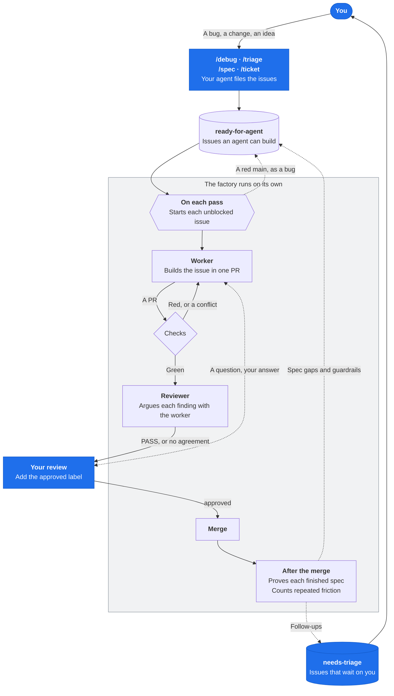

# skills
Dante's agent skills

## Quick start

You need T3 Code with **Settings → Labs → Workflows** on, a GitHub repo, and `gh` signed in.

1. Install every skill: `npx skills add dante-sparras/skills`.
2. Type `/factory` once in each repo you work in. It creates the labels, sets the model roles, and installs the factory.
3. Type the skill that fits what you have: `/debug` for a bug, `/ticket` for a small change, `/spec` then `/ticket` for a feature, `/triage` for the tracker.
4. Review each PR, and add the `approved` label when you are happy with it. The factory merges it. A PR that waits for you keeps its ticket's thread in your list in T3 Code, and every thread that is done settles itself. Type `/factory` again at any time to see everything that waits on you.

## How the skills fit together

Work moves in two halves: you shape it into issues with an agent, and the **factory** ships each issue on its own.



Blue is where you come in. A solid arrow follows one issue, from what you ask for to its merge. A dotted arrow is something the factory does unasked: it brings you a worker's question, and it files issues of its own.

1. **Shape.** Type the skill that fits what you have. Each one ends in an issue in `ready-for-agent` that an agent can build in one PR.

   | You have | Type |
   | --- | --- |
   | A bug | [`/debug`](./skills/debug/SKILL.md). It reproduces the bug, and files it with the steps |
   | A change that fits one PR, with nothing left to decide | [`/ticket`](./skills/ticket/SKILL.md). It files one ticket |
   | A feature | [`/spec`](./skills/spec/SKILL.md), then `/ticket`. `/spec` asks about whatever is still open, writes the spec, and offers to slice it |
   | A decision you want stress-tested before anything is written | [`/interview`](./skills/interview/SKILL.md) |
   | Issues nobody has looked at, or a PR with no issue | [`/triage`](./skills/triage/SKILL.md) |
   | A question the code cannot answer | [`/research`](./skills/research/SKILL.md), or ask in plain words |
   | A codebase that is hard to change | [`/deepen-modules`](./skills/deepen-modules/SKILL.md), then `/spec` |

2. **Ship.** The [factory](./skills/factory/factory.md) is a T3 Code workflow. It starts a **worker** for each ready issue whose blockers are closed, up to a limit per repo: at once when you file the issue or its blocker merges, and on a pass every ten minutes besides. The worker opens a PR, and wakes again for a red check, a conflict, or a collaborator's comment. Once the checks are green, the factory sends a **reviewer**, and the two argue each finding until they agree, for at most three rounds. Then the PR waits for your review: add the `approved` label, and the factory merges it. It never asks whether to open or merge a PR.
3. **Learn.** When a spec's last ticket lands, a reviewer proves the spec's user stories on main, and each gap becomes a ticket. Friction that repeats across runs becomes an issue the factory fixes with the `correct` skill. Follow-ups land in `needs-triage`, ready for step 1.

### What waits on you

The factory never rules or decides for you, and it merges only what you approved, unless you turn on `autoMerge` for a repo. Everything it needs from you waits in one of three places, and `/factory` lists them.

| Where | What waits there |
| --- | --- |
| The PR, on GitHub | Your review. Add the `approved` label, and the factory merges the PR. Comment or ask for changes, and the worker picks it up. Merging or closing it yourself works too. The factory's note on the PR lists what people outside the repo wrote, which the worker never sees: comment yourself to pass any of it on. GitHub does not let you approve a PR your own account opened, so the label is your approval. On a PR from another account, an approving review counts as well |
| The ticket's worker thread, in T3 Code | Notice that a PR is ready for your review: the thread stays in your list until the PR merges. Your ruling when the reviewer and the worker disagree. A worker's question, with the answers it suggests. The worker asks with its question tool, so T3 shows the thread as waiting on you. A question no thread could ask waits in T3 Code's **Workflows** page |
| `needs-triage` on the tracker | Follow-ups agents returned. Issues the factory stopped on, each with a comment that says why. Put `ready-for-agent` back on one to retry it |

[factory.md](./skills/factory/factory.md) says what the factory runs, what it does when main is red, how to install it, and which of its files holds what. [GLOSSARY.md](./GLOSSARY.md) defines the terms.

You type the skills in the table under **Shape**, and [`/factory`](./skills/factory/SKILL.md) once per repo, which sets the factory up. Every other skill is a tool an agent picks up when its work calls for it. Four load on their own in any session, when what you ask for matches: `research`, `debug`, `pr`, and `writing-for-agents`. The rest wait until the flow sends an agent there, or you type their name.

## Skills

Every skill lives at `skills/<name>/`, the same layout it installs to. The skills fall into six categories, listed in the order work happens.

| Category | Skill | What it does |
| --- | --- | --- |
| **Setup**: done once per repo | [factory](./skills/factory/SKILL.md) | Sets up the factory, shows what waits on you, and retries, stops, or pauses its runs |
| | [create-verify-skill](./skills/create-verify-skill/SKILL.md) | Generates a `verify-<app>` skill that drives the real app |
| **Define**: settle what to build | [interview](./skills/interview/SKILL.md) | Questions you in rounds until a decision or an idea is settled |
| | [triage](./skills/triage/SKILL.md) | Moves issues and outside PRs through triage states, up to `ready-for-agent` |
| | [research](./skills/research/SKILL.md) | Investigates a question against primary sources in the background, and reports what it found |
| | [glossary](./skills/glossary/SKILL.md) | Keeps the project's domain terms in `GLOSSARY.md` |
| **Plan**: write it down as issues | [spec](./skills/spec/SKILL.md) | Turns a conversation into a spec, asking about whatever is still open |
| | [ticket](./skills/ticket/SKILL.md) | Slices a spec, or a change that fits one PR, into tickets the factory builds |
| **Build**: make the change and prove it works | [tdd](./skills/tdd/SKILL.md) | Test-first for bug fixes and core logic, with tests worth keeping |
| | [prove](./skills/prove/SKILL.md) | Proves a change on the real artifact, and captures the evidence |
| | [debug](./skills/debug/SKILL.md) | Reproduces a bug or a slowdown and files it, or finds the cause and fixes it with a regression test |
| | [deepen-modules](./skills/deepen-modules/SKILL.md) | The deep-module vocabulary, and a survey that finds modules worth deepening |
| **Review**: get the change reviewed | [pr](./skills/pr/SKILL.md) | Writes a PR description: a summary diagram, evidence, and merge danger |
| | [review-pr](./skills/review-pr/SKILL.md) | Adversarial review of a PR against its ticket and spec, by models from different families |
| **Learn**: stop a mistake from repeating | [correct](./skills/correct/SKILL.md) | Turns a mistake agents repeat into a check that fails |
| | [writing-for-agents](./skills/writing-for-agents/SKILL.md) | Reference for writing skills and other docs that agents read |

## Install

`npx skills add dante-sparras/skills` puts every skill in your agent's skills folder, side by side: `<skills folder>/<name>/`.

To work from a clone instead, run `python scripts/link-skills.py`. It links every skill into `~/.claude/skills` and `~/.agents/skills`, or into the folders you name, and removes the links to skills that are gone. Run it again after a pull that adds, renames, or removes a skill.

Claude Code can also install the repo as one plugin that holds every skill:

```
/plugin install dante-skills --marketplace dante-sparras/skills
```

Install all of them. The skills reach each other by relative paths such as `../tdd/SKILL.md` and `../factory/model-roles.md`, so a skill installed alone loses them.

## Checks

Run `python3 scripts/check.py` before you push, or `python scripts/check.py` on Windows. CI runs the same command.

## Credits

- [mattpocock/skills](https://github.com/mattpocock/skills) by Matt Pocock
- [pstack](https://github.com/cursor/plugins/tree/main/pstack) by Lauren Tan
- [humanlayer/skills](https://github.com/humanlayer/skills) by Dex Horthy

## License

The upstream skills are by Matt Pocock and are used under the MIT License. See [LICENSES/mattpocock-skills.md](./LICENSES/mattpocock-skills.md).

The pstack skills are by Lauren Tan and are used under the MIT License. See [LICENSES/pstack.md](./LICENSES/pstack.md).
