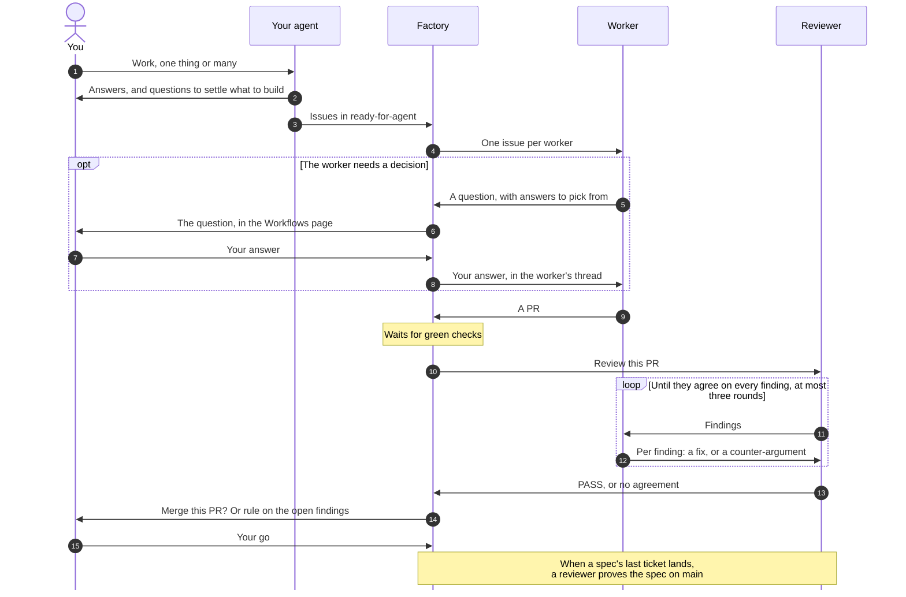

# skills
Dante's agent skills

## Quick start

You need T3 Code with **Settings → Labs → Workflows** on, a GitHub repo, and `gh` signed in.

1. Install every skill: `npx skills add dante-sparras/skills`.
2. Type `/setup-skills` once in each repo you work in. It writes the repo's settings and installs the factory.
3. Type `/factory` and say what you want done: a change, a bug, a feature.
4. Answer what the factory asks in T3 Code's **Workflows** page.

## How the skills fit together

Work moves in two halves: you shape it into issues with an agent, and the **factory** ships each issue on its own.

1. **Shape.** Type [`/factory`](./skills/factory/SKILL.md) and say what you want done, one thing or several: bugs, features, issues, questions, PRs. The agent you typed it to answers questions itself. Everything else becomes an issue in `ready-for-agent` that an agent can build in one PR, through `triage`, `interview`, `plan`, or `map`, with you in the conversation.
2. **Ship.** The [factory](./skills/factory/factory.md) is a T3 Code workflow. Every ten minutes it starts a **worker** for each ready issue whose blockers are closed, up to a limit per repo. The worker opens a PR, and wakes again for a red check, a conflict, or a collaborator's comment. Once the checks are green, the factory sends a **reviewer**, and the two argue each finding until they agree, for at most three rounds. Then the factory asks you before it merges.
3. **Learn.** When a spec's last ticket lands, a reviewer proves the spec's user stories on main, and each gap becomes a ticket. Friction that repeats across runs becomes an issue the factory fixes with the `correct` skill. Follow-ups land in `needs-triage`, ready for step 1.

### What waits on you

The factory never merges, rules, or decides for you. Everything it needs from you waits in one of two places.

| Where | What waits there |
| --- | --- |
| T3 Code's **Workflows** page | Each merge. Your ruling when the reviewer and the worker disagree. A worker's question, with the answers it suggests. A collaborator's request for changes that holds a PR. Comments from people outside the repo, which reach the worker only if you send them |
| `needs-triage` on the tracker | Follow-ups agents returned. Issues the factory stopped on, each with a comment that says why. Put `ready-for-agent` back on one to retry it |

### When main is red

The factory checks main on every pass. When a check fails there, it files one `bug` issue for the fix and starts nothing else in that repo until the issue closes, so no worker builds on a broken base.



Read the diagram top to bottom. Each arrow is a message, and the numbers give the order.

The flow lives in six files in `factory/`. [GLOSSARY.md](./GLOSSARY.md) defines the terms.

| File | Who reads it | What it holds |
| --- | --- | --- |
| [`factory/SKILL.md`](./skills/factory/SKILL.md) | The agent you type `/factory` to | How to turn what you want done into issues the factory can build |
| [`factory/factory.ts`](./skills/factory/factory.ts) | T3 Code | The factory itself |
| [`factory/factory.md`](./skills/factory/factory.md) | You, and `setup-skills` | What the factory runs, how to install it, and how to retry or stop a run |
| [`factory/worker.md`](./skills/factory/worker.md) | Every worker | How to build an issue in one PR and settle its review |
| [`factory/reviewer.md`](./skills/factory/reviewer.md) | The reviewer of a PR, or of a finished spec | How to review a PR and argue each finding with its worker, and how to check a spec |
| [`factory/rules.md`](./skills/factory/rules.md) | Workers and reviewers | Trust, the AI marker, results, messages, git, PR tools, and how to run a skill |

Every other skill is a tool an agent picks up when its work calls for it. None of them triggers on its own: an agent reads a skill only when the flow sends it there, and you can still type any of them. You type one more yourself: [setup-skills](./skills/setup-skills/SKILL.md), once per repo, which also installs the factory.

## Skills

Every skill lives at `skills/<name>/`, the same layout it installs to. The skills fall into seven categories, listed in the order work happens.

| Category | Skill | What it does |
| --- | --- | --- |
| **Run**: the one you start with | [factory](./skills/factory/SKILL.md) | The entry point. Turns what you want done into issues the factory ships |
| **Setup**: done once per repo | [setup-skills](./skills/setup-skills/SKILL.md) | Sets up a repo's tracker, labels, and model roles, and installs the factory |
| | [create-verify-skill](./skills/create-verify-skill/SKILL.md) | Generates a `verify-<app>` skill that drives the real app |
| **Define**: settle what to build | [interview](./skills/interview/SKILL.md) | Questions you in rounds until a plan or decision is settled |
| | [triage](./skills/triage/SKILL.md) | Moves issues and outside PRs through triage states |
| | [map](./skills/map/SKILL.md) | Charts work too big for one session as decision tickets |
| | [research](./skills/research/SKILL.md) | Investigates a question against primary sources in the background |
| | [glossary](./skills/glossary/SKILL.md) | Keeps the project's domain terms in `GLOSSARY.md` |
| **Plan**: write it down as a spec and tickets | [plan](./skills/plan/SKILL.md) | Turns a conversation into a spec and its tickets |
| **Build**: make the change and prove it works | [tdd](./skills/tdd/SKILL.md) | Test-first for bug fixes and core logic, and proof for everything else |
| | [debug](./skills/debug/SKILL.md) | Finds the cause of a hard bug or a slowdown, then fixes it with a regression test |
| | [deepen-modules](./skills/deepen-modules/SKILL.md) | The deep-module vocabulary, and a survey that finds modules worth deepening |
| **Review**: get the change reviewed | [pr](./skills/pr/SKILL.md) | Writes a PR description: a summary diagram, evidence, and merge danger |
| | [review-pr](./skills/review-pr/SKILL.md) | Adversarial review of a diff by models from different families |
| **Learn**: stop a mistake from repeating | [correct](./skills/correct/SKILL.md) | Turns a mistake agents repeat into a check that fails |
| | [writing-for-agents](./skills/writing-for-agents/SKILL.md) | Reference for writing skills and other docs that agents read |

## Install

`npx skills add dante-sparras/skills` puts every skill in your agent's skills folder, side by side: `<skills folder>/<name>/`. Linking each `skills/<name>/` folder by hand does the same.

Claude Code can also install the repo as one plugin that holds every skill:

```
/plugin install dante-skills --marketplace dante-sparras/skills
```

Install all of them. The skills reach each other by relative paths such as `../tdd/SKILL.md` and `../setup-skills/model-roles.md`, so a skill installed alone loses them.

## Checks

Run `python3 scripts/check.py` before you push, or `python scripts/check.py` on Windows. CI runs the same command.

## Credits

- [mattpocock/skills](https://github.com/mattpocock/skills) by Matt Pocock
- [pstack](https://github.com/cursor/plugins/tree/main/pstack) by Lauren Tan
- [humanlayer/skills](https://github.com/humanlayer/skills) by Dex Horthy

## License

The upstream skills are by Matt Pocock and are used under the MIT License. See [LICENSES/mattpocock-skills.md](./LICENSES/mattpocock-skills.md).

The pstack skills are by Lauren Tan and are used under the MIT License. See [LICENSES/pstack.md](./LICENSES/pstack.md).
