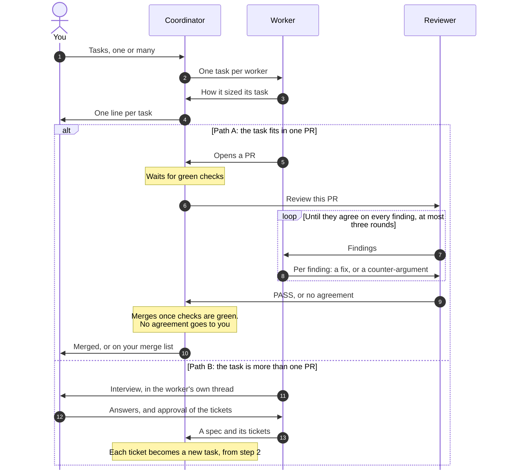

# skills
Dante's agent skills

## How the skills fit together

Start with [`/coordinate`](./skills/coordinate/SKILL.md) and hand it your tasks, one or several at once: bugs, features, issues, questions, PRs to merge. The agent you typed it to becomes the **coordinator**: the one agent you talk to, whose job is that every task ships.

One rule runs it all: **one task, one worker, one PR.** The skills are written for T3 Code: each worker is a `delegate_task` child with its own thread and checkout.

1. **The coordinator makes each thing a task** and starts a worker for it.
2. **The worker sizes its own task**, and the coordinator tells you how. If it fits in one PR, the worker builds it. It asks you about a single open decision in its own thread. If the task is more than one PR, the worker interviews you there, writes a spec and its tickets, and hands the tickets back. Each ticket becomes a new task.
3. **The coordinator sends a reviewer to each PR**, once its checks are green. The reviewer and the worker argue each finding until they agree: the worker fixes it, or the reviewer withdraws it. After three rounds without agreement, the coordinator brings both positions to you.
4. **The coordinator merges** once the checks are green again, or hands you a merge list when merging is yours.
5. **Anything that comes up becomes a new task**: a bug nobody owns, a teammate's review, a mistake that repeats.

Read the diagram top to bottom. Each arrow is a message, and the numbers give the order. A task takes path A or path B.

The whole flow is four files: one per role, and the rules they share. [GLOSSARY.md](./GLOSSARY.md) defines the terms.

| File | Who reads it | What it holds |
| --- | --- | --- |
| [`coordinate/SKILL.md`](./skills/coordinate/SKILL.md) | The coordinator | How to take in tasks, start workers, react to what comes back, and review and land PRs |
| [`coordinate/worker.md`](./skills/coordinate/worker.md) | Every worker | The four paths for a task: answer, talk it through, build, or split |
| [`coordinate/reviewer.md`](./skills/coordinate/reviewer.md) | The reviewer of a PR | How to review it, and argue each finding with its worker |
| [`coordinate/rules.md`](./skills/coordinate/rules.md) | All three | Trust, the AI marker, messages, git, PR tools, and how to run a skill |

Every other skill is a tool a worker picks up when its task calls for it. You type one more yourself: [setup-skills](./skills/setup-skills/SKILL.md), once per repo.

## Skills

Every skill lives at `skills/<name>/`, the same layout it installs to.

| Skill | What it does |
| --- | --- |
| [coordinate](./skills/coordinate/SKILL.md) | The entry point. Makes each request a task, starts a worker for it, and ships it |
| [debug](./skills/debug/SKILL.md) | Finds the cause of a hard bug or a slowdown, then fixes it with a regression test |
| [deepen](./skills/deepen/SKILL.md) | The deep-module vocabulary, and a survey that finds modules worth deepening |
| [glossary](./skills/glossary/SKILL.md) | Keeps the project's domain terms in `GLOSSARY.md` |
| [guardrail](./skills/guardrail/SKILL.md) | Turns a mistake agents repeat into a check that fails |
| [interrogate](./skills/interrogate/SKILL.md) | Adversarial review of a diff by models from different families |
| [interview](./skills/interview/SKILL.md) | Questions you in rounds until a plan or decision is settled |
| [map](./skills/map/SKILL.md) | Charts work too big for one session as decision tickets |
| [new-verify-skill](./skills/new-verify-skill/SKILL.md) | Generates a `verify-<app>` skill that drives the real app |
| [plan](./skills/plan/SKILL.md) | Turns a conversation into a spec and its tickets |
| [pr-body](./skills/pr-body/SKILL.md) | Writes a PR description: a summary diagram, evidence, and merge danger |
| [research](./skills/research/SKILL.md) | Investigates a question against primary sources in the background |
| [setup-skills](./skills/setup-skills/SKILL.md) | Sets up a repo's tracker, labels, and model roles for these skills |
| [tdd](./skills/tdd/SKILL.md) | Test-first for bug fixes and core logic, and proof for everything else |
| [triage](./skills/triage/SKILL.md) | Moves issues and outside PRs through triage states |
| [writing-for-agents](./skills/writing-for-agents/SKILL.md) | Reference for writing skills and other docs that agents read |

## Install

Install every skill into your agent's skills folder, side by side: `<skills folder>/<name>/`. `npx skills add` does this, and so does linking each `skills/<name>/` folder by hand.

The skills reach each other by relative paths such as `../tdd/SKILL.md` and `../setup-skills/MODEL-ROLES.md`, so a skill installed alone loses them.

The plugin manifest does not list `coordinate`, so a Claude plugin install leaves it out. Add it with `npx skills add` or a link.

Run `python3 scripts/check.py` before you push, or `python scripts/check.py` on Windows. CI runs the same command.

## Credits

- [mattpocock/skills](https://github.com/mattpocock/skills) by Matt Pocock
- [pstack](https://github.com/cursor/plugins/tree/main/pstack) by Lauren Tan
- [humanlayer/skills](https://github.com/humanlayer/skills) by Dex Horthy

## License

The upstream skills are by Matt Pocock and are used under the MIT License. See [LICENSES/mattpocock-skills.md](./LICENSES/mattpocock-skills.md).

The pstack skills are by Lauren Tan and are used under the MIT License. See [LICENSES/pstack.md](./LICENSES/pstack.md).
