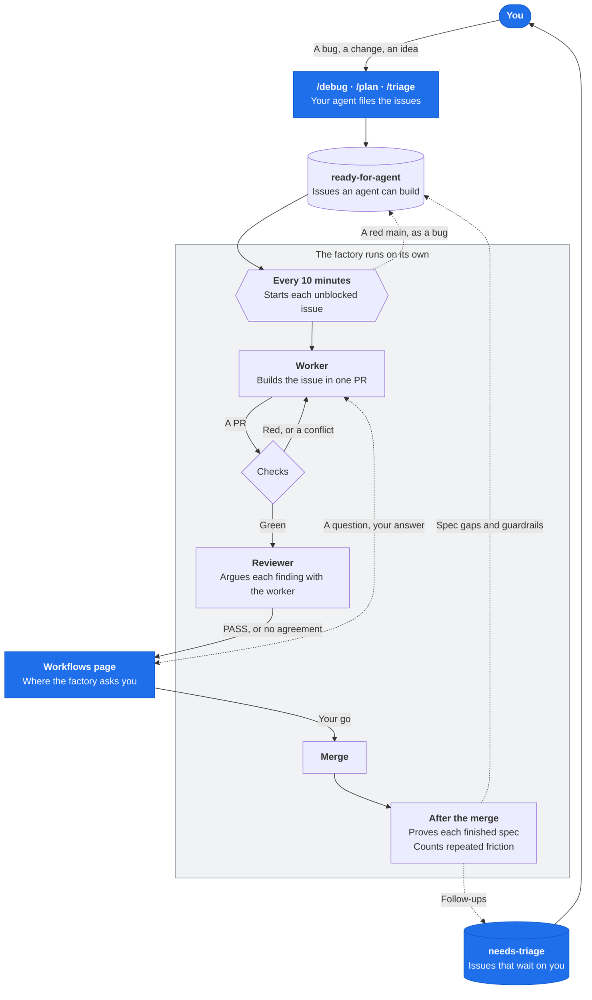

# skills
Dante's agent skills

## Quick start

You need T3 Code with **Settings → Labs → Workflows** on, a GitHub repo, and `gh` signed in.

1. Install every skill: `npx skills add dante-sparras/skills`.
2. Type `/setup-skills` once in each repo you work in. It writes the repo's settings and installs the factory.
3. Type the skill that fits what you have: `/debug` for a bug, `/plan` for a change, `/interview` then `/plan` for an idea, `/triage` for the tracker.
4. Answer what the factory asks in T3 Code's **Workflows** page.

## How the skills fit together

Work moves in two halves: you shape it into issues with an agent, and the **factory** ships each issue on its own.



Blue is where you come in. A solid arrow follows one issue, from what you ask for to its merge. A dotted arrow is something the factory does unasked: it brings you a worker's question, and it files issues of its own.

1. **Shape.** Type the skill that fits what you have. Each one ends in an issue in `ready-for-agent` that an agent can build in one PR.

   | You have | Type |
   | --- | --- |
   | A bug | [`/debug`](./skills/debug/SKILL.md). It reproduces the bug, and files it with the steps |
   | A change with nothing left to decide | [`/plan`](./skills/plan/SKILL.md). Work that fits one PR becomes one issue, and anything bigger a spec and its tickets |
   | A feature or an idea with questions still open | [`/interview`](./skills/interview/SKILL.md), then `/plan` |
   | Issues nobody has looked at, or a PR with no issue | [`/triage`](./skills/triage/SKILL.md) |
   | A question the code cannot answer | [`/research`](./skills/research/SKILL.md), or ask in plain words |
   | A codebase that is hard to change | [`/deepen-modules`](./skills/deepen-modules/SKILL.md), then `/plan` |

2. **Ship.** The [factory](./skills/setup-skills/factory/factory.md) is a T3 Code workflow. Every ten minutes it starts a **worker** for each ready issue whose blockers are closed, up to a limit per repo. The worker opens a PR, and wakes again for a red check, a conflict, or a collaborator's comment. Once the checks are green, the factory sends a **reviewer**, and the two argue each finding until they agree, for at most three rounds. Then the factory asks you before it merges.
3. **Learn.** When a spec's last ticket lands, a reviewer proves the spec's user stories on main, and each gap becomes a ticket. Friction that repeats across runs becomes an issue the factory fixes with the `correct` skill. Follow-ups land in `needs-triage`, ready for step 1.

### What waits on you

The factory never merges, rules, or decides for you. Everything it needs from you waits in one of two places.

| Where | What waits there |
| --- | --- |
| T3 Code's **Workflows** page | Each merge. Your ruling when the reviewer and the worker disagree. A worker's question, with the answers it suggests. A collaborator's request for changes that holds a PR. Comments from people outside the repo, which reach the worker only if you send them |
| `needs-triage` on the tracker | Follow-ups agents returned. Issues the factory stopped on, each with a comment that says why. Put `ready-for-agent` back on one to retry it |

### When main is red

The factory checks main on every pass. When a check fails there, it files one `bug` issue for the fix and starts nothing else in that repo until the issue closes, so no worker builds on a broken base.

The factory lives in six files in `setup-skills/factory/`, so it installs with the skills. [GLOSSARY.md](./GLOSSARY.md) defines the terms.

| File | Who reads it | What it holds |
| --- | --- | --- |
| [`factory.ts`](./skills/setup-skills/factory/factory.ts) | T3 Code | The factory itself |
| [`factory.md`](./skills/setup-skills/factory/factory.md) | You, and `setup-skills` | What the factory runs, how to install it, and how to retry or stop a run |
| [`handoff.md`](./skills/setup-skills/factory/handoff.md) | Any agent that files an issue for the factory | What an issue needs before the factory can build it |
| [`worker.md`](./skills/setup-skills/factory/worker.md) | Every worker | How to build an issue in one PR and settle its review |
| [`reviewer.md`](./skills/setup-skills/factory/reviewer.md) | The reviewer of a PR, or of a finished spec | How to review a PR and argue each finding with its worker, and how to check a spec |
| [`rules.md`](./skills/setup-skills/factory/rules.md) | Workers and reviewers | Trust, the AI marker, results, messages, git, PR tools, and how to run a skill |

You type the skills in the table under **Shape**, and [setup-skills](./skills/setup-skills/SKILL.md) once per repo, which also installs the factory. Every other skill is a tool an agent picks up when its work calls for it. Four load on their own in any session, when what you ask for matches: `research`, `debug`, `pr`, and `writing-for-agents`. The rest wait until the flow sends an agent there, or you type their name.

## Skills

Every skill lives at `skills/<name>/`, the same layout it installs to. The skills fall into six categories, listed in the order work happens.

| Category | Skill | What it does |
| --- | --- | --- |
| **Setup**: done once per repo | [setup-skills](./skills/setup-skills/SKILL.md) | Sets up a repo's tracker, labels, and model roles, and installs the factory |
| | [create-verify-skill](./skills/create-verify-skill/SKILL.md) | Generates a `verify-<app>` skill that drives the real app |
| **Define**: settle what to build | [interview](./skills/interview/SKILL.md) | Questions you in rounds until a plan or decision is settled |
| | [triage](./skills/triage/SKILL.md) | Moves issues and outside PRs through triage states, up to `ready-for-agent` |
| | [research](./skills/research/SKILL.md) | Investigates a question against primary sources in the background |
| | [glossary](./skills/glossary/SKILL.md) | Keeps the project's domain terms in `GLOSSARY.md` |
| **Plan**: write it down as issues | [plan](./skills/plan/SKILL.md) | Turns a conversation into one issue, or a spec and its tickets, for the factory |
| **Build**: make the change and prove it works | [tdd](./skills/tdd/SKILL.md) | Test-first for bug fixes and core logic, and proof for everything else |
| | [debug](./skills/debug/SKILL.md) | Reproduces a bug or a slowdown and files it, or finds the cause and fixes it with a regression test |
| | [deepen-modules](./skills/deepen-modules/SKILL.md) | The deep-module vocabulary, and a survey that finds modules worth deepening |
| **Review**: get the change reviewed | [pr](./skills/pr/SKILL.md) | Writes a PR description: a summary diagram, evidence, and merge danger |
| | [review-pr](./skills/review-pr/SKILL.md) | Adversarial review of a PR against its ticket and spec, by models from different families |
| **Learn**: stop a mistake from repeating | [correct](./skills/correct/SKILL.md) | Turns a mistake agents repeat into a check that fails |
| | [writing-for-agents](./skills/writing-for-agents/SKILL.md) | Reference for writing skills and other docs that agents read |

## Install

`npx skills add dante-sparras/skills` puts every skill in your agent's skills folder, side by side: `<skills folder>/<name>/`. Linking each `skills/<name>/` folder by hand does the same.

Claude Code can also install the repo as one plugin that holds every skill:

```
/plugin install dante-skills --marketplace dante-sparras/skills
```

Install all of them. The skills reach each other by relative paths such as `../tdd/SKILL.md` and `../setup-skills/model-roles.md`, so a skill installed alone loses them.

## Checks

Run `python3 scripts/check.py` before you push, or `python scripts/check.py` on Windows. CI runs the same command.

## Credits

- [mattpocock/skills](https://github.com/mattpocock/skills) by Matt Pocock
- [pstack](https://github.com/cursor/plugins/tree/main/pstack) by Lauren Tan
- [humanlayer/skills](https://github.com/humanlayer/skills) by Dex Horthy

## License

The upstream skills are by Matt Pocock and are used under the MIT License. See [LICENSES/mattpocock-skills.md](./LICENSES/mattpocock-skills.md).

The pstack skills are by Lauren Tan and are used under the MIT License. See [LICENSES/pstack.md](./LICENSES/pstack.md).
