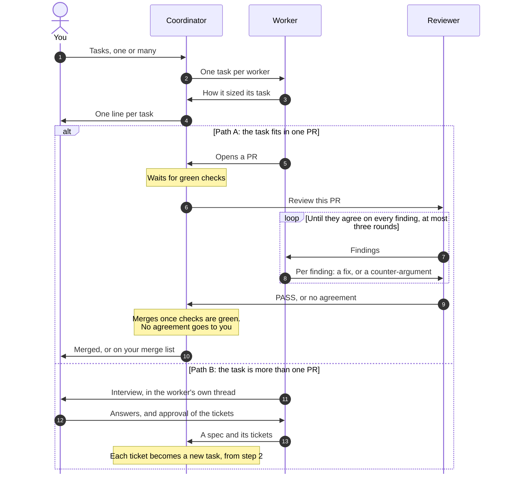

# skills
Dante's agent skills

## How the skills fit together

Start with [`/auto-mode`](./skills/auto-mode/SKILL.md) and hand it your tasks, one or several at once: bugs, features, issues, questions, PRs to merge. The agent you typed it to becomes the **coordinator**: the one agent you talk to, whose job is that every task ships.

One rule runs it all: **one task, one worker, one PR.** The skills are written for T3 Code: each worker is a `delegate_task` child with its own thread and checkout.

1. **The coordinator makes each thing a task** and starts a worker for it.
2. **The worker sizes its own task**, and the coordinator tells you how. If it fits in one PR, the worker builds it. It asks you about a single open decision in its own thread. If the task is more than one PR, the worker interviews you there, writes a spec and its tickets, and hands the tickets back. Each ticket becomes a new task.
3. **The coordinator sends a reviewer to each PR**, once its checks are green. The reviewer and the worker argue each finding until they agree: the worker fixes it, or the reviewer withdraws it. After three rounds without agreement, the coordinator brings both positions to you.
4. **The coordinator merges** once the checks are green again, or hands you a merge list when merging is yours.
5. **Anything that comes up becomes a new task**: a bug nobody owns, a teammate's review, a mistake that repeats.

Read the diagram top to bottom. Each arrow is a message, and the numbers give the order. A task takes path A or path B.

The whole flow is three files, one per role. [GLOSSARY.md](./GLOSSARY.md) defines the terms.

| File | Who reads it | What it holds |
| --- | --- | --- |
| [`auto-mode/SKILL.md`](./skills/auto-mode/SKILL.md) | The coordinator | The loop: intake, start, receive, review, land, check |
| [`auto-mode/worker.md`](./skills/auto-mode/worker.md) | Every worker | How to size a task, build it, or split it |
| [`auto-mode/reviewer.md`](./skills/auto-mode/reviewer.md) | The reviewer of a PR | How to review it, and argue each finding with its worker |

Every other skill is a tool a worker picks up when its task calls for it. You type one more yourself: [setup-skills](./skills/setup/setup-skills/SKILL.md), once per repo.

## Layout

The entry point, `auto-mode`, lives at `skills/auto-mode/` and belongs to no category. Every other skill lives at `skills/<category>/<name>/`. The four categories are also the groups the [skills CLI](https://skills.sh) shows, declared in `.claude-plugin/marketplace.json`.

| Category | Skills |
| --- | --- |
| `plan` | interview, wayfinder, to-spec, triage, research |
| `build` | tdd, diagnosing-bugs, code-review, pr, create-verification-skill |
| `codebase` | codebase-design, domain-modeling, improve-codebase-architecture, correct |
| `setup` | setup-skills, writing-for-agents |

## Install

Install every skill into your agent's skills folder, flat and side by side, each under its own name: `<skills folder>/<name>/`. `npx skills add` does this, and so does linking `skills/auto-mode/` and each `skills/<category>/<name>/` folder by hand.

The skills reach each other by the installed layout, with paths such as `../tdd/SKILL.md` and `../setup-skills/MODEL-ROLES.md`. Those paths cross category folders, so they resolve once installed and not inside this repo, and a skill installed alone loses them.

Run `python3 scripts/check.py` before you push. CI runs the same command.

## Upstream

The skills below started as copies of [mattpocock/skills](https://github.com/mattpocock/skills) at commit [`5863806dd4e15c63174bee4e7515a4256792ecfa`](https://github.com/mattpocock/skills/tree/5863806dd4e15c63174bee4e7515a4256792ecfa) and have been edited since. Each one lives in `skills/<category>/<name>/`.

### Engineering

- [code-review](./skills/build/code-review/SKILL.md)
- [codebase-design](./skills/codebase/codebase-design/SKILL.md)
- [diagnosing-bugs](./skills/build/diagnosing-bugs/SKILL.md)
- [domain-modeling](./skills/codebase/domain-modeling/SKILL.md)
- [improve-codebase-architecture](./skills/codebase/improve-codebase-architecture/SKILL.md)
- [pr](./skills/build/pr/SKILL.md)
- [research](./skills/plan/research/SKILL.md)
- [setup-skills](./skills/setup/setup-skills/SKILL.md)
- [tdd](./skills/build/tdd/SKILL.md)
- [to-spec](./skills/plan/to-spec/SKILL.md)
- [triage](./skills/plan/triage/SKILL.md)
- [wayfinder](./skills/plan/wayfinder/SKILL.md)

### Productivity

- [interview](./skills/plan/interview/SKILL.md)
- [writing-for-agents](./skills/setup/writing-for-agents/SKILL.md)

### pstack

These skills started from pstack, or are new here and built on its ideas:

- [auto-mode](./skills/auto-mode/SKILL.md)
- [correct](./skills/codebase/correct/SKILL.md)
- [create-verification-skill](./skills/build/create-verification-skill/SKILL.md)

[correct](./skills/codebase/correct/SKILL.md) started as a copy of the `correct` skill in Lauren Tan's [pstack](https://github.com/cursor/plugins/tree/e5136d82418d2db3165ea1050d17577cd618cc05/pstack) at commit [`e5136d82418d2db3165ea1050d17577cd618cc05`](https://github.com/cursor/plugins/tree/e5136d82418d2db3165ea1050d17577cd618cc05/pstack/skills/correct). It also absorbs the upstream `retro` skill from mattpocock/skills.

[code-review](./skills/build/code-review/SKILL.md) takes its adversarial reviewer panel from the `interrogate` skill in pstack at commit [`ab1f702ce8e8b6557edb56b09f52cde8bfb83f17`](https://github.com/cursor/plugins/tree/ab1f702ce8e8b6557edb56b09f52cde8bfb83f17/pstack/skills/interrogate): the adversary brief, picking reviewers from different model families, and rerunning each finding before it is reported.

[tdd](./skills/build/tdd/SKILL.md) takes its test-first rules from pstack at commit [`35a90942a7f02e1ebbc2443643179815f2147954`](https://github.com/cursor/plugins/tree/35a90942a7f02e1ebbc2443643179815f2147954/pstack/skills/tdd): the bug-fix loop that sees red before the fix, when to skip a test, the closest checks that prove skipped work, the guardrails, and the evidence report. It also takes the two imagined edits that judge a test from [`principle-test-behavior-not-implementation`](https://github.com/cursor/plugins/tree/35a90942a7f02e1ebbc2443643179815f2147954/pstack/skills/principle-test-behavior-not-implementation), real-artifact proof from [`principle-prove-it-works`](https://github.com/cursor/plugins/tree/35a90942a7f02e1ebbc2443643179815f2147954/pstack/skills/principle-prove-it-works), and the red-then-green commit order and same-surface verification from the [Bug fix playbook](https://github.com/cursor/plugins/blob/35a90942a7f02e1ebbc2443643179815f2147954/pstack/skills/poteto-mode/playbooks/bug-fix.md). Seams, vertical slices, and the mocking and test examples stay from mattpocock/skills.

[create-verification-skill](./skills/build/create-verification-skill/SKILL.md) started as a copy of the `create-verification-skill` skill in pstack at commit [`e58dd043600587dbaf58ba315e7f2b38373eeb43`](https://github.com/cursor/plugins/tree/e58dd043600587dbaf58ba315e7f2b38373eeb43/pstack/skills/create-verification-skill), including its feature map example.

[auto-mode](./skills/auto-mode/SKILL.md) takes its entry point from the `poteto-mode` skill in pstack at commit [`7a583913eb1b8d1a0ee76753d1a2cf072e7b54f9`](https://github.com/cursor/plugins/tree/7a583913eb1b8d1a0ee76753d1a2cf072e7b54f9/pstack/skills/poteto-mode): one user-invoked skill a person starts every task with, and a `worker.md` that opens every subagent's brief, since the rules reach a subagent no other way. Its build flow follows the poteto-mode playbooks at commit [`35a90942a7f02e1ebbc2443643179815f2147954`](https://github.com/cursor/plugins/tree/35a90942a7f02e1ebbc2443643179815f2147954/pstack/skills/poteto-mode/playbooks): one worker and one PR per task off trunk, an independent verdict before a PR lands, the forge-approval guardrail, and the hand-off mode. The coordinator loop and the worker's sizing table are new here.

[setup-skills](./skills/setup/setup-skills/SKILL.md) takes its model role configuration from Lauren Tan's [pstack](https://github.com/cursor/plugins/tree/main/pstack).

### Other credits

[pr](./skills/build/pr/SKILL.md) adapts its visual examples and placement guidance from Dex Horthy's [`show-me` skill](https://github.com/humanlayer/skills/blob/main/plugins/show-me/skills/show-me/SKILL.md).

[codebase-design](./skills/codebase/codebase-design/DESIGN-IT-TWICE.md) uses John Ousterhout's Design It Twice method.

## License

The upstream skills are by Matt Pocock and are used under the MIT License. See [LICENSES/mattpocock-skills.md](./LICENSES/mattpocock-skills.md).

The pstack skills are by Lauren Tan and are used under the MIT License. See [LICENSES/pstack.md](./LICENSES/pstack.md).
