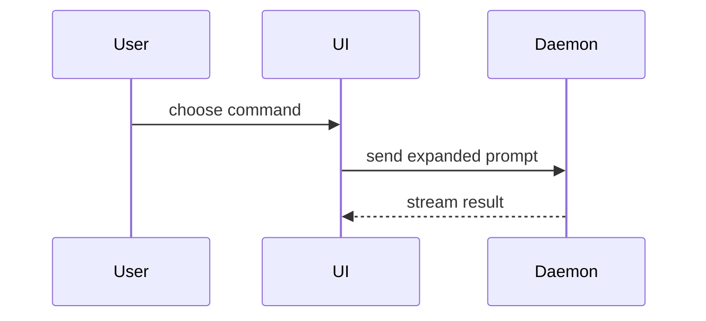

Title the PR in the repo's commit convention, and as `type(scope): subject` when it has none. A squash merge makes the title the commit subject.

Write the body from this template:

```markdown
## Summary

<diagram, diff-sketch, or tree>

## Evidence

- **Before:** <screenshot/output/failing test run>
  **After:** <screenshot/output/passing test run>

## Merge Danger

**Door:** <one-way or two-way>

<optional: description>

**Blast Radius:** <what the change could affect, in one line>

<optional: potential ramifications of merge>

Closes #<issue>
```

Keep the `Closes` line for each issue the PR resolves, and drop it when there is none.

## Sections

Start each section with its content, keep prose brief, and use the domain language from `GLOSSARY.md`.

### Summary

Pick the smallest view that makes the key point clear. One or two usually do. Place each next to the short text it supports, and keep only the calls, files, props, states, and boundaries that show what this PR changes.

- Show logic or an algorithm as pseudocode:

```text
on(save)
  if content is unchanged
    return cached result
  write new content
  return fresh result
```

- Show runtime control flow as a call tree:

```text
submitForm
  createSession
    persistPrompt
    launchAgent
  navigateToSession
```

- Show UI structure as a component tree, including state and module boundaries that matter:

```text
<SessionPage> (apps/example/src/routes/session.tsx)
  useSessionEvents()
  <SessionToolbar>
    <RunSkillButton> (packages/ui)
```

- Show file responsibility or a broad refactor as a shallow file tree:

```text
src/
├── commands/       # parses user actions
├── sessions/       # owns session state
└── transport/      # sends API requests
```

- Show component interaction, control flow, or data flow with Mermaid:



- Use `diff` when the point is what changes and the surrounding shape already exists. Match the diff shape to the topic.

For a component change:

```diff
 <SessionPage>
   useSessionEvents()
   <SessionToolbar>
+    <RunSkillButton />
   <SessionTimeline>
+    <SkillResultCard />
```

For a file-layout change:

```diff
 src/
 ├── commands/
+│   └── expand-skill.ts  # expands the slash command
 ├── sessions/
-└── transport.ts
+└── transport/
+    ├── client.ts
+    └── stream.ts
```

For a call-tree or call-stack change:

```diff
 submitForm
   createSession
     persistPrompt
+    expandSkillMention
     launchAgent
-  navigateToSession
+  navigateToSession
+    subscribeToEvents
```

For a state or control-flow change:

```diff
 on(save)
-  write content
+  if content is unchanged
+    return cached result
+  write new content
+  invalidate cache
```

- Show the whole block when most of it is new, when omitted context would hide ownership or order, or when the user needs a copyable target shape:

```ts
function expandSkill(command: string): string {
  const skillName = command.slice(1);
  return `use the ${skillName} skill`;
}
```

### Evidence

Show that the change works, before and after.

- **A visual change**: screenshots, when the environment can take them.
- **Anything else**: a run. Name the exact test or command and paste its real output, failing before the change and passing after.

### Merge Danger

- **Door**: two-way when the change is cheap to roll back. One-way when it involves a destructive action or a decision that is hard to reverse.
- **Blast radius**: everything the change could affect, such as layout shift, breakage for consumers, or mobile responsiveness.
